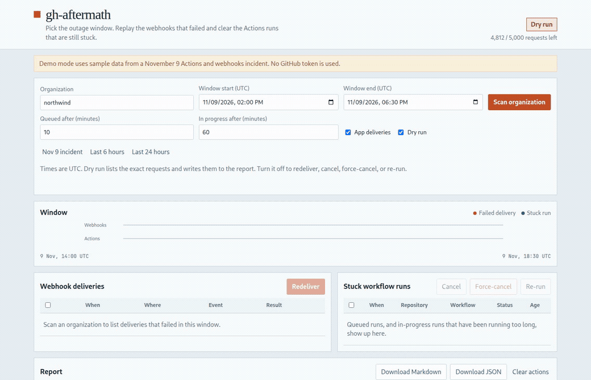
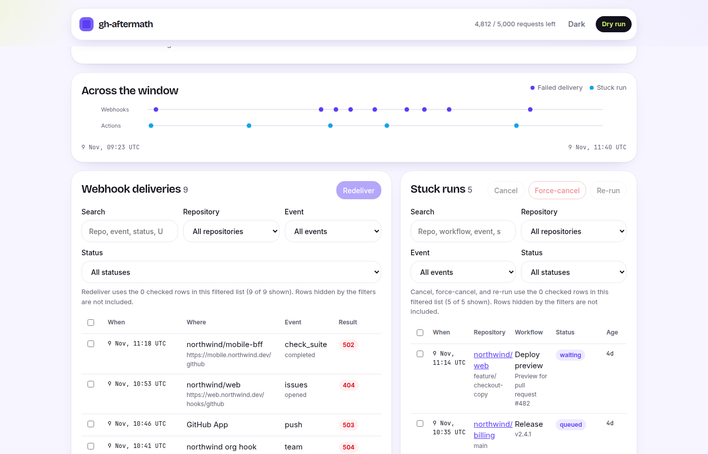
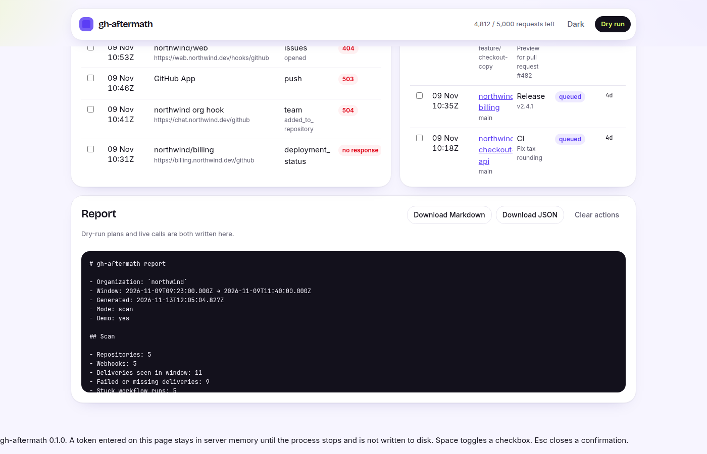

# gh-aftermath

[English](README.md) | [Türkçe](README.tr.md)

[](https://github.com/bymustfa/gh-aftermath/actions/workflows/ci.yml)
[](https://github.com/bymustfa/gh-aftermath/actions/workflows/codeql.yml)
[](https://github.com/bymustfa/gh-aftermath/actions/workflows/scorecard.yml)
[](LICENSE)
[](#quick-start)

Self-hosted web UI that cleans up an organization after a GitHub outage: replay the webhook deliveries that failed, and clear the Actions runs that are still stuck.

## The problem

When Actions or webhooks degrade, two kinds of work are left behind. Webhook deliveries fail or never get a response, and workflow runs sit in `queued` (or stay `in_progress` long after they should have finished). Replaying those by hand, one repository at a time, is how a short incident turns into a long afternoon.

On November 9, 2026, GitHub reported a degradation of Actions and webhooks. The same window is what people were comparing notes about on [Hacker News](https://news.ycombinator.com/item?id=50458532). gh-aftermath is a local tool for that kind of cleanup. It is not a status page and it does not speak for GitHub.

## Features

- Organization-wide scan over a UTC time window
- Bulk webhook redelivery for repository hooks, organization hooks, and GitHub App deliveries
- Cancel, force-cancel, and re-run for Actions runs that are still queued or in progress
- Search and filters on the delivery and run lists
- Dry-run by default, with the exact request shown before anything is sent
- Downloadable JSON and Markdown reports
- Demo mode with sample data, so you can click through the screen without a token

## Demo







## Quick start

Node.js 20 or newer. The package is not on npm yet.

```bash
git clone https://github.com/bymustfa/gh-aftermath.git
cd gh-aftermath
npm ci
npm run build
npm start -- --demo
```

Open http://localhost:8787. Demo mode uses the sample organization `northwind` and does not call GitHub.

Live mode is the same server without `--demo`. Set `GITHUB_TOKEN` and `GITHUB_ORG`, or start with no token and paste one into the page. A token entered on the page stays in that server process's memory only.

```bash
npm start
```

`npx` is coming soon, after the package is published:

```bash
npx gh-aftermath --demo
```

Docker image: not published. Build it locally:

```bash
docker build -t gh-aftermath .
docker run --rm -p 8787:8787 gh-aftermath --demo
docker run --rm -p 8787:8787 -e GITHUB_TOKEN -e GITHUB_ORG=your-org gh-aftermath
```

| Variable | Purpose |
| --- | --- |
| `GITHUB_TOKEN` | Personal access token for the scan, redelivery, and Actions |
| `GITHUB_ORG` | Organization filled in on the form |
| `GITHUB_APP_ID` | App id, required for App hook deliveries |
| `GITHUB_APP_PRIVATE_KEY` or `GITHUB_APP_PRIVATE_KEY_PATH` | App private key |
| `GITHUB_APP_INSTALLATION_ID` | Installation used when the app scans instead of a token |
| `PORT` / `HOST` | Default `8787` and `0.0.0.0` |
| `DEMO=1` | Same as `--demo` |

## Token scopes

Classic personal access token:

| Scope | Used for |
| --- | --- |
| `repo` | Private repositories, and Actions cancel, force-cancel, and re-run |
| `read:org` | Listing the organization's repositories |
| `admin:repo_hook` | Repository webhook deliveries and redelivery |
| `admin:org_hook` | Organization webhook deliveries and redelivery |

Fine-grained token, limited to the organization you are cleaning up:

- Metadata: Read
- Actions: Read and write
- Webhooks: Read and write
- Administration: Read, when listing hooks requires it
- Organization webhooks: Read and write, for organization hooks

GitHub App installation: Actions read and write, Webhooks read and write, and Metadata read. App deliveries (`/app/hook/...`) authenticate with the app JWT, so set `GITHUB_APP_ID` and the private key. Set `GITHUB_APP_INSTALLATION_ID` as well when the app, rather than a token, should scan the organization.

Revoke the token when the incident is over.

## Security

Run it yourself. The token is read from the environment, or from the masked field on the page, and kept in memory for that process only. It is not written to disk, not stored in the browser, and not copied into the report or the logs. Dry-run is the default: GitHub is called only after you turn dry-run off and confirm. See [SECURITY.md](SECURITY.md) for how to report a vulnerability.

## Alternatives

GitHub's own redelivery example is a [script for one repository](https://docs.github.com/en/webhooks/using-webhooks/automatically-redelivering-failed-deliveries-for-a-repository-webhook). `webhook-redeliver-action` replays deliveries for one repository from inside Actions. [Hookdeck](https://hookdeck.com/) is a webhook platform for routing, inspecting, and replaying events. gh-aftermath is the org-wide pass for the outage window: failed deliveries and stuck Actions runs together, on a machine you control, with a report you can keep.

## Related

[hook-stage](https://github.com/bymustfa/hook-stage) is for local webhook development and inspection. gh-aftermath is for the recovery after an outage.

## Contributing

See [CONTRIBUTING.md](CONTRIBUTING.md). Issues labeled for newcomers are listed at [good first issues](https://github.com/bymustfa/gh-aftermath/issues?q=is%3Aissue+is%3Aopen+label%3A%22good+first+issue%22).

## License

[MIT](LICENSE)
