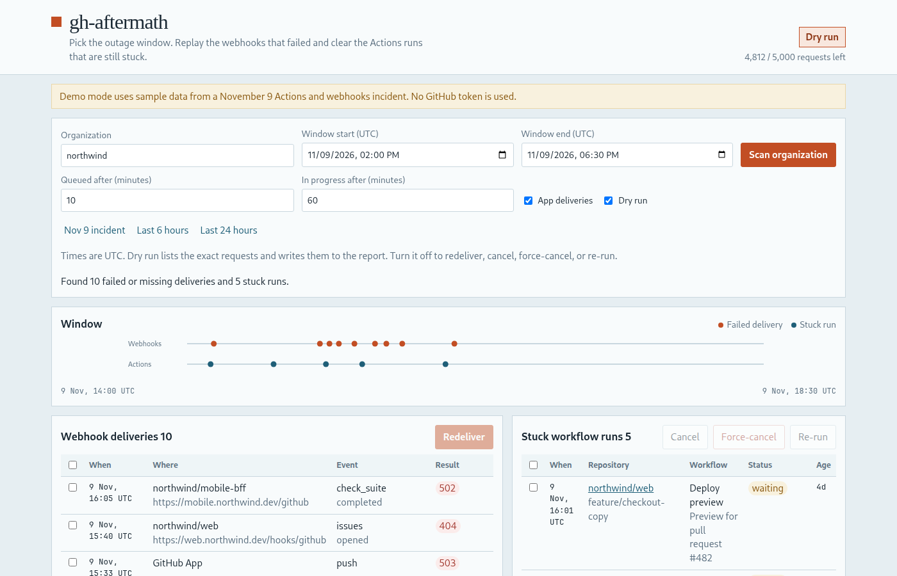
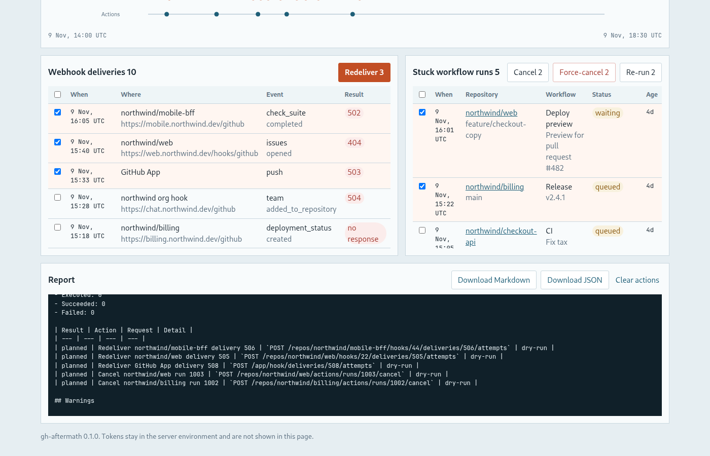
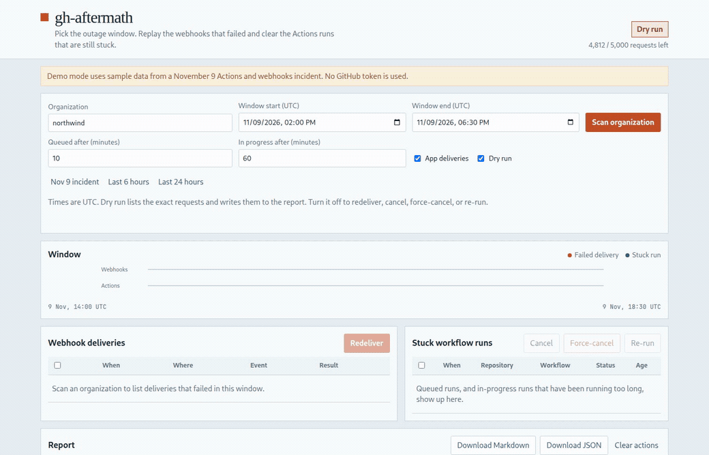

# gh-aftermath

[English](README.md)

[](https://github.com/bymustfa/gh-aftermath/actions/workflows/ci.yml)
[](https://github.com/bymustfa/gh-aftermath/actions/workflows/codeql.yml)
[](https://github.com/bymustfa/gh-aftermath/actions/workflows/scorecard.yml)
[](LICENSE)
[](https://www.npmjs.com/package/gh-aftermath)

GitHub kesintisinden sonra ortalığı toplamak için kendi sunucunuzda çalışan bir web arayüzü. Kesinti aralığını seçersiniz. Araç, kuruluştaki depo webhook'larını, kuruluş webhook'larını ve GitHub App teslimatlarını tarar; başarısız veya yanıtsız kalan teslimatları listeler. Aynı aralıkta kuyrukta kalmış ya da fazla uzun süredir çalışan Actions işlerini de gösterir. Yeniden teslim, iptal, zorla iptal ve yeniden çalıştırma aynı ekrandan yapılır.

Deneme çalıştırma (dry-run) varsayılan olarak açıktır. Ekranda GitHub'a gidecek `POST` isteğinin tam yolu görünür. Planlanan veya yapılan işlerin JSON ve Markdown raporu indirilebilir.

npm rozeti yer tutucudur. 0.1.0 yayımlanmadı, `package.json` private işaretli, ve yayın akışı npm'e paket basmaz, GitHub Release de oluşturmaz.







## Neden

9 Kasım Actions ve webhook kesintisinden sonra derlemeler kuyrukta kaldı, webhook'lar elle yeniden oynatıldı, bazı işler iptal edilemedi. GitHub'ın kendi örneği tek depo için bir betik. `webhook-redeliver-action` tek depoyu Actions içinden oynatır. VS Code webhook araçları tek kancayı yönetir. Hookdeck ücretli bir webhook platformu.

gh-aftermath kuruluş genelinde ve zaman aralığına göre çalışır: webhook'lar ve takılı işler birlikte, kendi makinenizde çalışan bir arayüzde, saklayabileceğiniz bir raporla.

## Kurulum

Node 20 veya daha yenisi.

```bash
npx gh-aftermath --demo
```

`npx gh-aftermath` paket yayımlandıktan sonra çalışır. O zamana kadar kaynaktan veya konteynerden çalıştırın:

```bash
npm install
npm run build
npx gh-aftermath --demo
```

Docker:

```bash
docker build -t gh-aftermath .
docker run --rm -p 8787:8787 gh-aftermath --demo
docker run --rm -p 8787:8787 -e GITHUB_TOKEN -e GITHUB_ORG=kurulusunuz gh-aftermath
```

http://localhost:8787 adresini açın.

## Kullanım

1. Kuruluşu ve UTC aralığını girin. Demo modu 9 Kasım örnek kesintisiyle açılır.
2. **Dry run** işaretliyken tarayın.
3. Teslimatları ve işleri seçin. Yeniden teslim, iptal, zorla iptal veya yeniden çalıştırın. Rapor her `POST` yolunu yazar.
4. Dry-run'ı kapatıp aynı işlemleri GitHub'a göndermek için tekrarlayın.
5. Raporu Markdown veya JSON olarak indirin.

```bash
gh-aftermath --help
gh-aftermath --demo --port 8787 --org northwind
```

| Değişken | Amaç |
| --- | --- |
| `GITHUB_TOKEN` | Kuruluş taraması, yeniden teslim ve Actions için PAT |
| `GITHUB_ORG` | Formda görünen kuruluş |
| `GITHUB_APP_ID` | `/app/hook` teslimatları için uygulama kimliği |
| `GITHUB_APP_PRIVATE_KEY` veya `GITHUB_APP_PRIVATE_KEY_PATH` | Uygulama özel anahtarı |
| `GITHUB_APP_INSTALLATION_ID` | PAT yerine uygulama ile tarama |
| `PORT` / `HOST` | Varsayılan `8787` ve `0.0.0.0` |
| `DEMO=1` | `--demo` ile aynı |
| `CONCURRENCY` | Eşzamanlı GitHub çağrısı. Varsayılan 4 |
| `MAX_PAGES` | Her listeden okunan 100'lük sayfa sayısı. Varsayılan 20 |

Belirteç yalnızca sunucuda okunur. Sayfada belirteç alanı yoktur ve raporlara yazılmaz.

### Neler işaretlenir

- Durum kodu 400 veya daha yüksekse teslimat başarısızdır. Kod `0` veya boşsa yanıt yok sayılır. GitHub durumu `OK` / `success` değilse de başarısızdır.
- Teslimatlar yeniden eskiye okunur. Sayfa, aralığın başlangıcından eskiye düşünce sayfalama durur.
- Bir iş `queued`, `waiting`, `pending` veya `requested` ise, aralıkta oluşturulduysa ve kuyruk eşiğinden eskiyse (varsayılan 10 dakika) takılı sayılır.
- Bir iş `in_progress` ise, aralıkta başladıysa ve eşikten uzun sürdüyse (varsayılan 60 dakika) takılı sayılır.
- Bitmiş işler listelenmez. GitHub yalnızca güncel durumu döner.

Yeniden teslim resmi uçları kullanır:

- `POST /repos/{owner}/{repo}/hooks/{hook_id}/deliveries/{delivery_id}/attempts`
- `POST /orgs/{org}/hooks/{hook_id}/deliveries/{delivery_id}/attempts`
- `POST /app/hook/deliveries/{delivery_id}/attempts`

Takılı işler `POST /repos/{owner}/{repo}/actions/runs/{run_id}/cancel`, `.../force-cancel` ve `.../rerun` kullanır.

Octokit, retry ve throttling eklentileriyle kurulur. Birincil ve ikincil hız sınırları üç denemeye kadar yeniden denenir.

## Belirteç yetkileri

Klasik PAT:

| Yetki | Kullanım |
| --- | --- |
| `repo` | Özel depolar ve Actions iptal / zorla iptal / yeniden çalıştırma |
| `admin:repo_hook` | Depo webhook teslimatları ve yeniden teslim |
| `admin:org_hook` | Kuruluş webhook teslimatları ve yeniden teslim |
| `read:org` | Kuruluş depolarını listeleme |

İnce ayarlı belirteç:

- Metadata: Read
- Actions: Read and write
- Webhooks: Read and write
- Administration: Read, kancaları listelemek için gerekiyorsa
- Organization webhooks: Read and write, kuruluş kancaları için kuruluş belirtecinde

GitHub App kurulumu:

- Actions: Read and write
- Webhooks: Read and write
- Metadata: Read

App teslimatları (`GET` ve `POST /app/hook/...`) uygulama JWT'si ile kimlik doğrular. `GITHUB_APP_ID` ve özel anahtar gerekir. Taramayı PAT yerine uygulama yapacaksa `GITHUB_APP_INSTALLATION_ID` de gerekir.

## Geliştirme

```bash
npm run lint
npm run typecheck
npm test
npm run build
npm run demo
```

GitHub API kararları `src/core` ve `src/github` içindedir. Arayüz Octokit'i doğrudan çağırmaz.

`release-please` bir Node paketi için ayarlıdır. `skip-github-release` açıktır ve `.github/workflows/release-please.yml` içindeki npm publish işi yorum satırındadır. Yayımlamak için `"private": true` kaldırılmalı ve sahibi `workflow_dispatch` ile onaylamalıdır. Scorecard sonuçları bu özel depoda kalır (`publish_results: false`).

## İlgili

[hook-stage](https://github.com/bymustfa/hook-stage) yerel webhook geliştirme ve inceleme içindir. gh-aftermath bir kesintiden sonra kuruluşu toparlamak içindir: başarısız teslimatları yeniden oynatır, hâlâ takılı işleri temizler.

## Lisans

[MIT](LICENSE)
